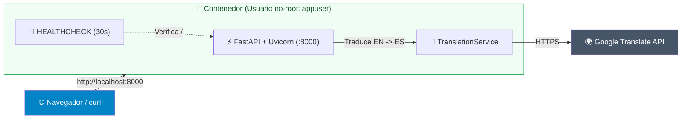

# Secure Translator — Aplicación de Traducción con Docker

Aplicación web que traduce texto de **Inglés → Español** usando FastAPI como backend y Google Translate (vía `deep-translator`) como motor de traducción. Diseñada para ejecutarse en un contenedor Docker.



---

## Estructura del proyecto

```
translate/
├── app.py              # API REST con FastAPI
├── translate.py        # Lógica de traducción (TranslationService)
├── index.html          # Interfaz web
├── requirements.txt    # Dependencias Python
└── Dockerfile          # Imagen multi-stage para producción
```

---

## Requisitos previos

- [Docker](https://docs.docker.com/get-docker/) instalado y corriendo.
- Conexión a internet (la traducción consume la API pública de Google Translate).

Verifica que Docker esté activo:

```bash
docker --version
docker info
```

---

## Construcción de la imagen

Desde el directorio `translate/`, ejecuta:

```bash
docker build -t secure-translator:1.0 .
```

El Dockerfile utiliza **multi-stage build**:
- **Etapa 1 (`builder`):** compila las dependencias como wheels precompilados.
- **Etapa 2 (final):** copia solo los wheels y el código, resultando en una imagen más ligera y segura.

Para verificar el tamaño de la imagen generada:

```bash
docker images secure-translator
```

---

## Ejecución del contenedor

```bash
docker run -d \
  --name translator \
  -p 8000:8000 \
  secure-translator:1.0
```

| Parámetro | Descripción |
|---|---|
| `-d` | Ejecuta en segundo plano (detached) |
| `--name translator` | Nombre del contenedor |
| `-p 8000:8000` | Mapea el puerto 8000 del host al contenedor |

Una vez iniciado, abre el navegador en:

```
http://localhost:8000
```

---

## Verificar que el contenedor está corriendo

```bash
# Ver el estado del contenedor
docker ps

# Ver los logs en tiempo real
docker logs -f translator

# Verificar el healthcheck
docker inspect --format='{{.State.Health.Status}}' translator
```

El contenedor incluye un **healthcheck** automático que consulta `http://localhost:8000/` cada 30 segundos. Los estados posibles son: `starting`, `healthy`, `unhealthy`.

---

## Endpoints disponibles

| Método | Ruta | Descripción |
|---|---|---|
| `GET` | `/` | Interfaz web HTML |
| `POST` | `/api/translate` | Traduce un texto |
| `GET` | `/health` | Estado del servicio |
| `GET` | `/docs` | Documentación Swagger UI (automática) |

### Probar la API desde la terminal

```bash
# Traducción de texto
curl -X POST http://localhost:8000/api/translate \
  -H "Content-Type: application/json" \
  -d '{"text": "Hello, how are you?"}'
```

Respuesta esperada:
```json
{
  "original": "Hello, how are you?",
  "translation": "Hola como estas"
}
```

```bash
# Healthcheck manual
curl http://localhost:8000/health
```

Respuesta esperada:
```json
{"status": "ok"}
```

---

## Detener y limpiar el contenedor

```bash
# Detener el contenedor
docker stop translator

# Eliminar el contenedor
docker rm translator

# Eliminar la imagen (opcional)
docker rmi secure-translator:1.0
```

En un solo comando:

```bash
docker stop translator && docker rm translator
```

---

## Límites y validaciones

| Parámetro | Límite |
|---|---|
| Longitud máxima del texto | 5,000 caracteres |
| Longitud mínima del texto | 1 carácter |
| Idioma origen | Inglés (`en`) |
| Idioma destino | Español (`es`) |

Si el texto supera el límite, la API retorna `HTTP 422 Unprocessable Entity`.

---

## Dependencias

| Paquete | Versión | Uso |
|---|---|---|
| `fastapi` | 0.104.1 | Framework web API REST |
| `uvicorn[standard]` | 0.24.0 | Servidor ASGI de producción |
| `pydantic` | 2.5.0 | Validación de datos de entrada |
| `deep-translator` | 1.11.4 | Cliente de Google Translate |
| `python-multipart` | 0.0.6 | Soporte de formularios en FastAPI |

---

## Notas de seguridad

- El contenedor corre con un **usuario no-root** (`appuser`) para minimizar el riesgo de escalada de privilegios.
- La interfaz web usa `innerText` para renderizar la traducción, previniendo ataques **XSS**.
- El botón de traducción se deshabilita durante la petición para prevenir envíos duplicados.


---

<div align="center">

[⬅️ Lab 1A: Docker Básico](../ejercicio-docker.md) · [🏠 Índice Principal](../../../README.md) · [Lab 2A: Kubernetes Stateless ➡️](../../lab2-kubernetes/ejercicio-stateless.md)

</div>
