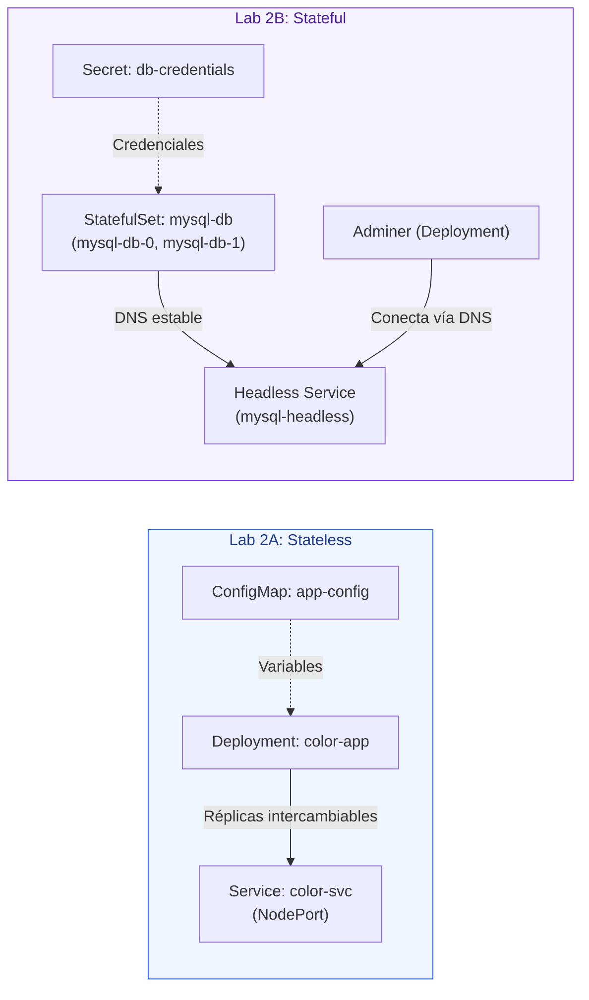

# ☸️ Lab 2: Despliegues en Kubernetes (Stateless vs Stateful)

En este bloque aprenderás la diferencia práctica entre desplegar aplicaciones **sin estado (Stateless)** y aplicaciones **con estado (Stateful)** en Kubernetes.

## 📂 Ejercicios Disponibles

| Orden | Ejercicio | Conceptos Clave | Guía |
| :---: | :--- | :--- | :---: |
| **2A** | **Aplicación Web Stateless** | `Deployment`, `ConfigMap`, `Service (NodePort)` | [🌐 Ir al Ejercicio Stateless](./ejercicio-stateless.md) |
| **2B** | **Base de Datos Stateful + Adminer** | `StatefulSet`, `Secret`, `Headless Service`, DNS interno | [🗄️ Ir al Ejercicio Stateful](./ejercicio-stateful.md) |

---

[⬅️ Lab 1B: Secure Translator](../lab1-docker/translate/README.md) · [🏠 Índice Principal](../../README.md) · [Lab 2A: Stateless ➡️](./ejercicio-stateless.md)

