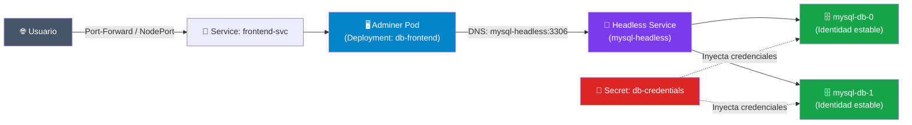

# Ejercicio: Despliegue Stateful (Base de Datos y Frontend)

**Objetivo:** Aprender a gestionar datos sensibles con **Secrets**, desplegar bases de datos usando **StatefulSets** y conectar aplicaciones usando **Deployments**.

En este ejercicio utilizaremos los manifiestos que se encuentran en la carpeta `stateful/`:
- `stateful/secret.yaml`: Contiene las credenciales de la base de datos de forma segura.
- `stateful/statefulset-db.yaml`: Despliega un clúster MySQL con 2 réplicas ordenadas (`mysql-db-0` y `mysql-db-1`) y un servicio *Headless* (`mysql-headless`).
- `stateful/frontend.yaml`: Despliega la aplicación `Adminer` para administrar la base de datos visualmente.



> **💡 Nota de Arquitectura:** Este laboratorio se enfoca en la **identidad de red estable** (`mysql-db-0.mysql-headless`, `mysql-db-1.mysql-headless`) sin requerir un *StorageClass* previo. En entornos de producción, además agregarías `volumeClaimTemplates` al `StatefulSet` para que cada réplica tenga su propio `PersistentVolumeClaim` dedicado.

## 1. Desplegar los recursos

Desde la carpeta `laboratorios/lab2-kubernetes/`, aplica los manifiestos en tu clúster de Kubernetes ejecutando:

```bash
kubectl apply -f stateful/secret.yaml
kubectl apply -f stateful/statefulset-db.yaml
kubectl apply -f stateful/frontend.yaml
```
*(O aplica toda la carpeta de una vez con `kubectl apply -f stateful/`)*.

## 2. Verificar el despliegue

Revisa que los Pods (`mysql-db-0`, `mysql-db-1` y `db-frontend`), el StatefulSet, los Services y el Secret se hayan creado y estén en estado `Running`:

```bash
kubectl get statefulset,pods,svc,secrets
```

## 3. Probar la conexión a la base de datos

1. **Abre la interfaz web de Adminer:**
   - **Opción A — Con Port-Forward (funciona en cualquier clúster):**
     ```bash
     kubectl port-forward svc/frontend-svc 8080:80
     ```
     Luego ingresa desde tu navegador a `http://localhost:8080`.
   - **Opción B — Con NodePort / Minikube:**
     Identifica el puerto `3XXXX` en `kubectl get svc frontend-svc` y abre `http://<IP-NODO>:<PUERTO-NODEPORT>`, o en Minikube ejecuta:
     ```bash
     minikube service frontend-svc --url
     ```
2. **Inicia sesión en Adminer** usando las credenciales definidas en `stateful/secret.yaml`:
   * **Sistema / Motor:** `MySQL`
   * **Servidor:** `mysql-headless` *(o conectarte a una réplica específica usando su identidad DNS estable: `mysql-db-0.mysql-headless`)*
   * **Usuario:** `dbuser`
   * **Contraseña:** `dbpassword123`
   * **Base de datos:** `testdb`

Al dar clic en **Entrar**, verás la interfaz de administración de la base de datos `testdb`. ¡Esto confirma que tu Frontend (`Deployment`) resolvió el DNS interno de Kubernetes y se conectó exitosamente a tu base de datos (`StatefulSet`)!

## 4. Limpieza de recursos

Una vez finalizado el laboratorio, elimina los recursos para liberar espacio en tu clúster:

```bash
kubectl delete -f stateful/
```


---

<div align="center">

[⬅️ Lab 2A: Stateless](./ejercicio-stateless.md) · [🏠 Índice Principal](../../README.md)

</div>
